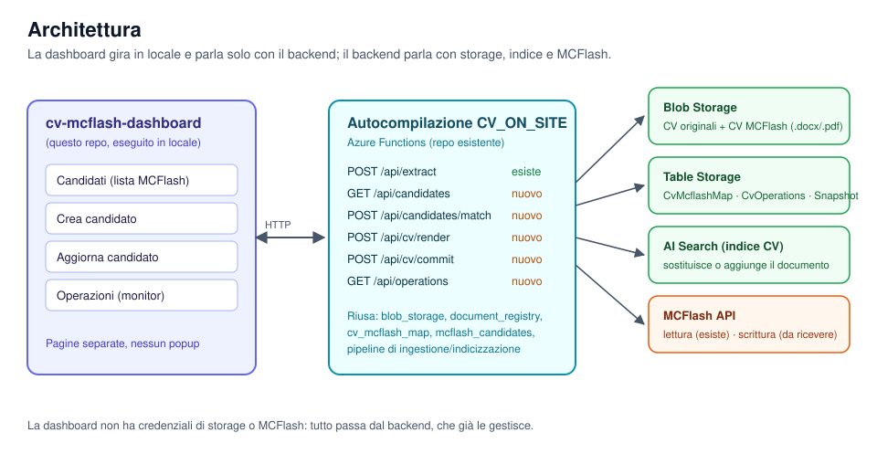
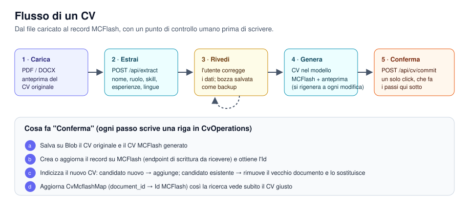
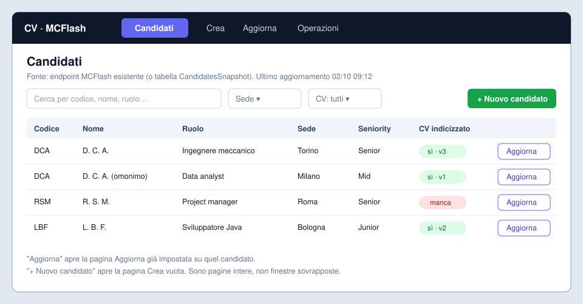
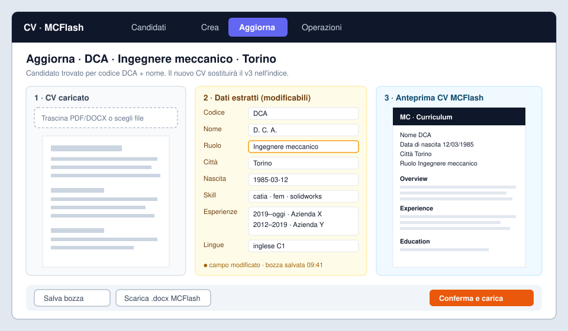
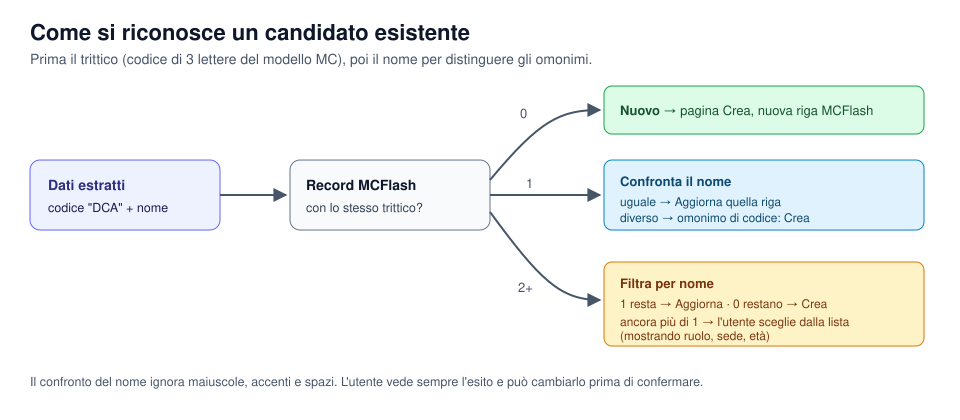
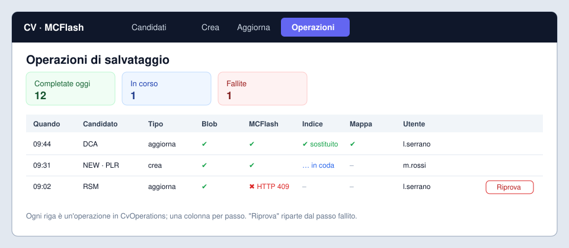
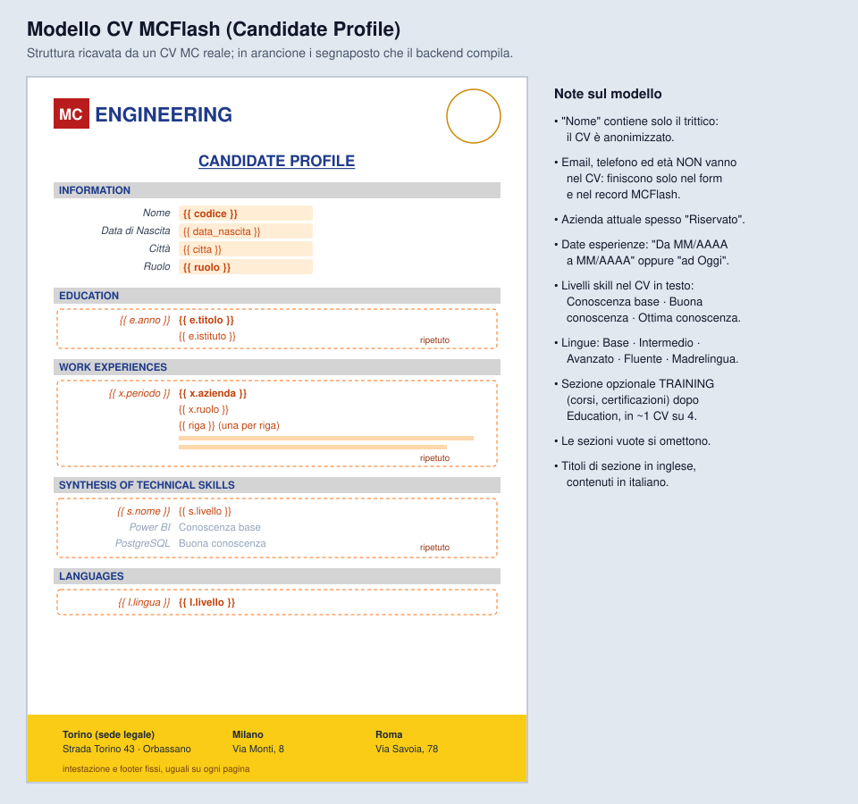

# cv-mcflash-dashboard

Dashboard per portare un CV su MCFlash. Si carica il CV e si estraggono i dati. Chi ha caricato il file li corregge, poi genera il CV nel modello MCFlash e lo vede in anteprima. Alla conferma la dashboard crea o aggiorna il candidato su MCFlash e salva e indicizza i CV.

Il backend resta nel repo esistente **Autocompilazione CV_ON_SITE** (Azure Functions): lì c'è già l'estrazione e lì vanno i nuovi endpoint. Questo repo contiene solo l'interfaccia, che per ora gira in locale. Per il front end non si usano servizi Azure: se andrà pubblicata, si userà un hosting gratuito.

> Stato: fasi 1–6 fatte: lista dei candidati, caricamento ed estrazione del CV, form di revisione con bozze salvate, anteprima del CV MC, conferma (storage, MCFlash finto, indice, mappa) e monitor delle operazioni. Prossima: rifinitura e prova con CV reali (fase 7). Il piano di lavoro è in [docs/PIANO.md](docs/PIANO.md).

## Avvio in locale

1. **Backend** (repo Autocompilazione CV_ON_SITE, con il suo `.venv` attivo). Per caricare solo gli endpoint della dashboard, senza i trigger su blob e code dello storage reale:
   ```
   func start --functions candidates candidate_detail candidate_hide candidate_cv candidates_match cv_finder_search cv_file cv_finder_link roles cv_filename mc_levels extract save_draft get_draft delete_draft list_drafts draft_original cv_render cv_commit_route get_operation retry_operation list_operations
   ```
2. **Dashboard** (questo repo):
   ```
   py -3.12 -m venv .venv
   .venv\Scripts\pip install -r requirements.txt
   copy .env.example .env        # BACKEND_URL, e FUNCTION_KEY se il backend è su Azure
   .venv\Scripts\streamlit run app.py
   ```
   Si apre su http://localhost:8501.
3. **Test**: `.venv\Scripts\python -m pytest`

### Struttura

```
app.py                     # entry Streamlit, navigazione nella barra laterale (st.navigation)
views/candidati.py         # home: lista, un filtro per campo MCFlash, Aggiorna per riga
views/aggiorna.py          # aggiorna?id=<IdMCFlash>: si apre sul CV attuale, o su un CV nuovo (&nuovo=1)
views/crea.py              # nuovo candidato (fase 3)
views/operazioni.py        # monitor (fase 6)
dashboard/config.py        # BACKEND_URL, FUNCTION_KEY da .env o dai secrets di Streamlit
dashboard/api.py           # client HTTP verso il backend
dashboard/components/      # chiamate con cache, testi derivati dalle righe candidato
assets/                    # logo e icona della barra laterale
tests/
```

---

## L'idea in sei immagini

### 1. Architettura



La dashboard chiama solo il backend. Le credenziali di Blob, Table Storage, AI Search e MCFlash restano nelle Functions, che le gestiscono già oggi.

### 2. Il flusso di un CV



1. **Carica**: PDF o DOCX, con l'anteprima del file originale.
2. **Estrai**: `POST /api/extract` (esistente) restituisce nome, ruolo, città, nascita, skill, esperienze, lingue e titoli.
3. **Rivedi**: i dati sono in un form modificabile. Ogni modifica viene salvata come bozza, così resta un backup anche se si chiude la pagina.
4. **Genera**: il backend compila il modello MCFlash con i dati corretti e la dashboard mostra l'anteprima, che si aggiorna dopo ogni modifica.
5. **Conferma**: un solo pulsante salva i file, scrive su MCFlash, indicizza e aggiorna la mappa CV → MCFlash. Ogni passo viene registrato.

### 3. Pagina Candidati (home)



È la lista dei candidati MCFlash, letta con l'endpoint e la tabella che usiamo già. Per ogni riga si vede se esiste un CV indicizzato e di che versione. Il pulsante **Aggiorna** apre la pagina Aggiorna già impostata su quel candidato. **+ Nuovo candidato** apre la pagina Crea.

### 4. Pagine Crea e Aggiorna



Le due pagine hanno lo stesso schema a tre colonne: **CV caricato**, **dati estratti modificabili** e **anteprima del CV MCFlash**. Cambia solo l'esito della conferma: *Crea* aggiunge una riga su MCFlash e un nuovo documento all'indice. *Aggiorna* modifica la riga esistente e sostituisce il vecchio CV nell'indice.

Sono pagine intere, raggiungibili dalla barra laterale: nessun popup, nessuna finestra sovrapposta.

### 5. Come si riconosce un candidato esistente



Il primo criterio è il **trittico**, cioè il codice di 3 lettere nell'intestazione del modello MC (es. `DCA`). Lo stesso trittico può appartenere a persone diverse, quindi a parità di trittico decide il **nome**. Se restano più candidati, l'utente sceglie dalla lista. L'esito è sempre visibile e si può cambiare prima di confermare.

### 6. Monitor delle operazioni



Ogni conferma è un'operazione registrata in una tabella (`CvOperations`), con una colonna per passo: Blob, MCFlash, indice, mappa. Se un passo fallisce, l'operazione si ferma lì e **Riprova** riparte da quel passo.

---

## Regole su storage e indice

| Caso | CV originale e CV MCFlash su Blob | Indice AI Search | Mappa `CvMcflashMap` |
|---|---|---|---|
| Candidato **nuovo** | aggiunti | nuovo documento **aggiunto** | nuova riga `document_id → Id MCFlash` |
| Candidato **esistente** | aggiunti come nuova versione; i vecchi restano su Blob come storico | il vecchio documento viene **rimosso e sostituito** | la riga punta al nuovo `document_id` |

Il salvataggio usa gli stessi container e la stessa pipeline di ingestione di oggi (`incoming-cv`, `incoming-cv-originals`, `DocumentRegistry`).

## Scelte tecniche proposte

- **Frontend**: Python + [Streamlit](https://streamlit.io), multipagina, avviato in locale con `streamlit run`. È lo stesso linguaggio del backend, ogni tab è una pagina vera e non serve un servizio web app. Niente servizi Azure per il front end: se più avanti servirà pubblicarlo, si usa un hosting gratuito (proposta: Streamlit Community Cloud, app privata con accesso solo agli invitati), senza riscriverlo.
- **Anteprima CV originale**: PDF mostrato direttamente; DOCX convertito in HTML per la visualizzazione.
- **CV MCFlash**: generato dal backend a partire dal modello `.docx` con segnaposto. L'anteprima è la conversione in PDF o HTML.
- **Bozze**: salvate dal backend (Blob `cv-drafts/`) e non solo nel browser, così il backup sopravvive al cambio di PC.

## Il modello MCFlash



Il modello è ricostruito da un CV MC reale ("Candidate Profile") ed è già nel backend: `templates/cv_mcflash.docx` e `templates/cv_mcflash.dotx`. Sezioni, segnaposto, trittico e regole sui nomi file sono in [docs/MODELLO_MCFLASH.md](docs/MODELLO_MCFLASH.md). Email, telefono ed età si estraggono e si modificano nel form, ma finiscono solo sul record MCFlash: il CV resta anonimo, con il solo trittico.

## Decisioni e stato

- **Email, telefono, età**: si estraggono e vanno nel form e su MCFlash, mai nel CV.
- **Modello `.docx`/`.dotx`**: fatto, provato su due CV reali.
- **Estrazione estesa**: fatta, con `POST /api/extract?profile=mcflash`.
- **Trittico**: prima lettera del nome + prime due lettere del cognome.
- **Nome file**: `GET /api/cv/filename` propone una variante libera per un candidato nuovo e il nome attuale per un aggiornamento, così l'indice sostituisce il vecchio CV.
- **Endpoint MCFlash di scrittura**: arriverà dopo. Il segnaposto è `MCFLASH_CANDIDATI_WRITE_URL` nel backend; finché è vuoto si lavora con un MCFlash finto.

Il dettaglio è nel [piano](docs/PIANO.md).
